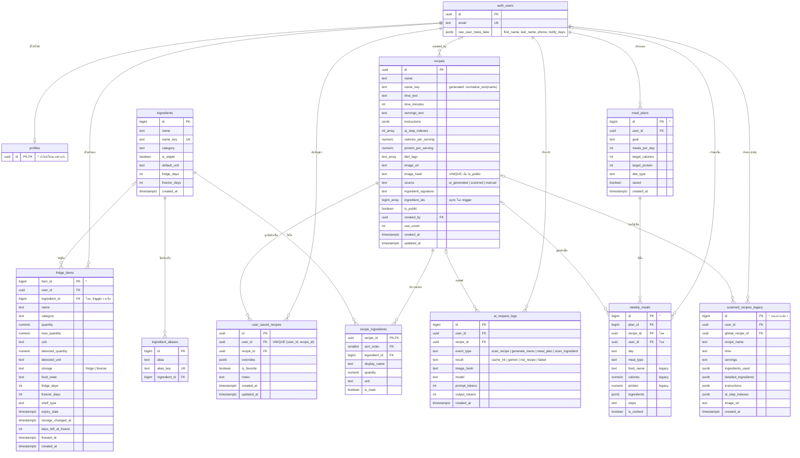

# SmartFridge.AI — ER Diagram

อัปเดตล่าสุด: 6 พ.ย. 2026 · ตรงกับ [data_dictionary.md](data_dictionary.md) และ migration `20261104000000_global_recipes.sql` + `20261104000100_contract_legacy_recipes.sql`

- `auth_users` = ตาราง `auth.users` ของ Supabase Auth
- **\*** ในคำอธิบาย = ตารางเดิมที่ไม่มี DDL ในโปรเจกต์ (คอลัมน์อนุมานจากโค้ด Flutter)
- ชนิด `*_array` = array ของ PostgreSQL เช่น `bigint_array` = `BIGINT[]`

## วิธีอ่านเส้นความสัมพันธ์

| สัญลักษณ์ | ความหมาย | ตัวอย่าง |
|---|---|---|
| `\|\|--o{` | 1 ต่อ 0..N (FK ห้ามว่าง) | 1 สูตร มีส่วนผสม 0..N แถว |
| `\|o--o{` | 0..1 ต่อ 0..N (FK เป็น NULL ได้) | มื้ออาหารอาจยังไม่ผูกสูตรกลาง |
| `\|\|--o\|` | 1 ต่อ 0..1 | ผู้ใช้ 1 คน มีโปรไฟล์ได้ไม่เกิน 1 แถว |

## จุดสำคัญ

- **recipes ↔ ingredients เป็น M:N** ผ่าน `recipe_ingredients` (PK รวม `recipe_id + sort_order`)
- **user_saved_recipes** เป็นตารางกลางระหว่างผู้ใช้กับสูตรกลาง — ผู้ใช้แก้สูตรได้ผ่าน `overrides` โดยไม่กระทบสูตรของคนอื่น
- **fridge_items.ingredient_id** และ **weekly_meals.recipe_id** เป็น FK ที่ NULL ได้ (ข้อมูลเดิมอาจจับคู่ไม่ได้)
- **scanned_recipes_legacy** เลิกใช้แล้ว เก็บไว้อ้างอิงผ่าน `global_recipe_id` เท่านั้น
- ON DELETE: ลบผู้ใช้ → ลบ fridge/saved/logs/meals ของผู้ใช้ (CASCADE) แต่ `recipes.created_by` กลายเป็น NULL (สูตรสาธารณะยังอยู่)
